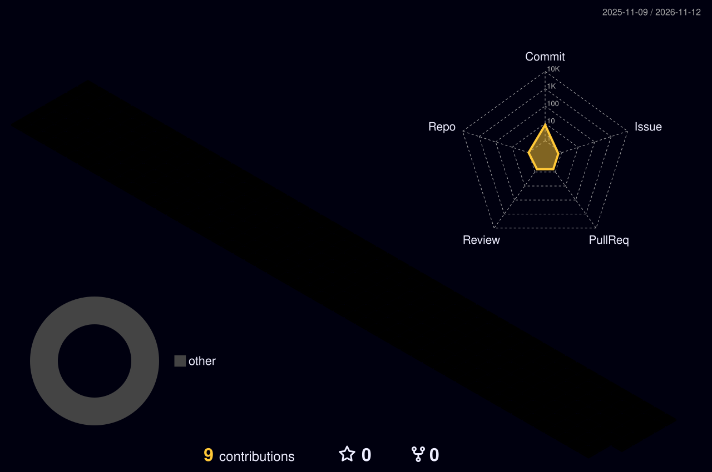

  
  
  

  

    
    
  

---

### 🎯 Про мене
Студент **Львівської політехніки** (Internet of Things)...

---

### ⚔️ Мій рівень розробника

  

---

### 🛠️ Стек

  

---

### 🏙️ 3D Коміти

  

---

### 🐍 Мої коміти (Змійка)

  

---

### 💼 Мої проєкти
| Проєкт | Опис | Стек |
| :--- | :--- | :--- |
| **[Kostex Portfolio](https://kostex.vercel.app)** | Мій особистий сайт-візитка | Next.js, Tailwind |

---

  <h3>📫 Зв'язатися</h3>
  
  
  
  
    
  

