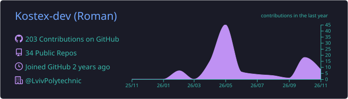
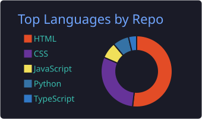
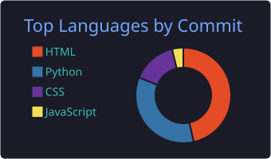
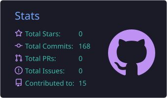

<!-- ==================== ХЕДЕР ==================== -->

  

  

    

  <!-- НАКРУТКА ПЕРЕГЛЯДІВ НА 3000 -->
  
  

    

  
  

 

<!-- ==================== ПРО МЕНЕ ==================== -->
<h2 align="center">Про мене</h2>

  <i>Створюю сучасні цифрові продукти та перетворюю ідеї на працюючі рішення.</i>

  <table>
    <tr>
      <td width="50%" valign="top">
         
        <b>Привіт, я Роман.</b> 👋  
        Я Full-Stack розробник та студент спеціальності <b>Інтернет речей (IoT)</b> у Львівській політехніці.  
        Мені подобається досліджувати нові технології та створювати інтерфейси, які хочеться використовувати. Вважаю, що хороший софт — це не просто код, а насамперед досвід, який отримує людина.
      </td>
      <td width="50%" valign="top">
         
        📍 <b>Локація:</b> Львів, Україна 🇺🇦  
        🎓 <b>Освіта:</b> Львівська політехніка  
        💻 <b>Фокус:</b> Full-Stack / IoT  
        🚀 <b>Статус:</b> Відкритий до пропозицій
      </td>
    </tr>
  </table>

 

<!-- ==================== СТЕК ==================== -->
<h2 align="center">Технологічний Стек</h2>

  <i>Інструменти, які стоять за моєю роботою.</i>

  

 

<!-- ==================== ГОЛОВНИЙ ПРОЄКТ ==================== -->
<h2 align="center">Головний Проєкт</h2>

  
    
  
  <h3>KOSTEX — Digital Products Studio</h3>
  
  
<b>Перетворюю ідеї на цифрові продукти.</b>

  
  
Мій особистий проєкт, зосереджений на створенні сучасних веб-сайтів, застосунків та індивідуальних рішень.

  

    

  
    
  

 

<!-- ==================== СТАТИСТИКА ==================== -->
<h2 align="center">Статистика GitHub</h2>

  <i>Реальна активність. Реальний прогрес.</i>

  <!-- ЦІ КАРТИНКИ ГЕНЕРУЮТЬСЯ В ТВОЄМУ РЕПОЗИТОРІЇ І НІКОЛИ НЕ ЗЛАМАЮТЬСЯ -->
  
  
  
    
  
  
  

 

<!-- ==================== ЗМІЙКА ==================== -->
<h2 align="center">Мої коміти</h2>

  

 

<!-- ==================== КОНТАКТИ ==================== -->
<h2 align="center">Зв'язатися зі мною</h2>

  
Маєш цікаву ідею або хочеш співпрацювати? Я завжди відкритий до нових викликів.

  
  
  
  
  

     

  <b>ДУМАЙ. СТВОРЮЙ. ВДОСКОНАЛЮЙ.</b>
   
  © 2026 РОМАН КОСТЕЦЬКИЙ · KOSTEX.DEV

<!-- ==================== ФУТЕР ==================== -->

  

